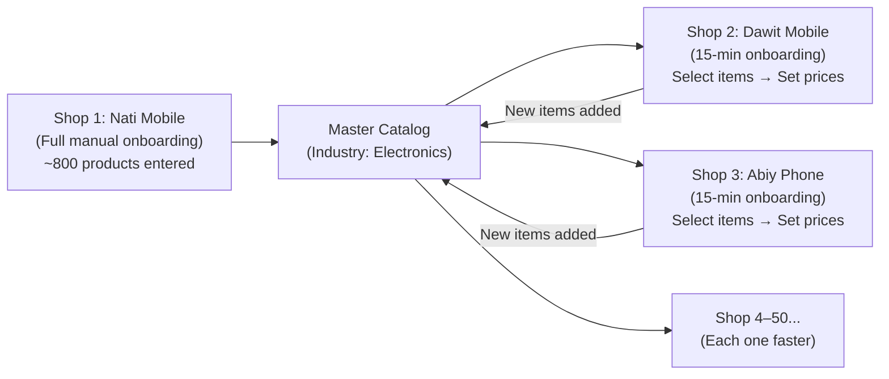

# Neil Lewz → Multi-Tenant Retail SaaS: Business Opportunity Assessment

> **Prepared for:** Nate Yonas (Potential Investor / Partner)
> **Prepared by:** Yirael Tibebu
> **Date:** October 14, 2026
> **Exchange Rate Used:** 1 USD = 162 ETB (CBE mid-market, Oct 2026)

---

## Executive Summary

We have built a production-grade retail management platform (Neil Lewz) that already handles POS checkout, inventory tracking with barcode/QR scanning, Ethiopian digital payment verification (CBE Birr & Telebirr OCR), Telegram bot notifications, stock movement ledger, label generation, and role-based access control. The platform runs on Next.js 16 + Supabase and is deployed on Vercel.

**The proposal:** Convert this single-tenant system into a multi-tenant SaaS product and sell it to small-to-mid retail businesses across Addis Ababa and secondary Ethiopian cities.

**Why this is not another generic POS:** Our platform solves three problems that no competitor in Ethiopia currently solves well simultaneously:
1. **Digital payment fraud prevention** — automated OCR verification of CBE/Telebirr transfer receipts eliminates fake screenshot scams
2. **Cashier theft prevention** — operator PIN attribution, append-only stock ledger, barcode-enforced checkout
3. **Zero data-entry onboarding** — Master Catalog system where the second shop in any vertical gets pre-loaded inventory from the first

---

## 1. The Ethiopian Market: Hard Numbers

| Metric | Value | Source |
| :--- | :--- | :--- |
| MSMEs as % of all private businesses in Ethiopia | **>90%** | World Bank / MSME surveys |
| Share of businesses in wholesale & retail trade | **40–43%** | Ethiopian trade registration data |
| Registered retail & wholesale operators in Addis Ababa | **100,000 – 140,000+** | Addis Ababa Trade Bureau |
| Licensed pharmacies & drug stores (Addis Ababa) | **Hundreds** (tightly regulated by EFDA) | EFDA / Regional Health Bureau |
| Urban population (Addis Ababa metro) | **~5.4 million** | CSA 2024 estimate |
| Smartphone penetration (urban Ethiopia) | **~45–50%** | GSMA Intelligence |
| Telebirr registered users (nationwide) | **>40 million** | Ethio Telecom reports |

> [!IMPORTANT]
> The addressable market is not 140,000 shops. It's the subset that: (a) does 20+ transactions/day, (b) accepts digital payments (CBE/Telebirr), and (c) has a smartphone or laptop. Conservative estimate: **8,000–15,000 shops in Addis Ababa alone** fit this profile.

---

## 2. Industry Vertical Deep Dive

### Tier 1: Launch-Ready (Existing code covers 85–100% of needs)

#### A. Mini-Markets & Superettes
| Factor | Assessment |
| :--- | :--- |
| **Market Size (Addis)** | ~3,000–5,000 formal mini-markets |
| **Average Daily Transactions** | 50–200 |
| **Average Monthly Revenue** | 200,000 – 800,000 ETB ($1,200 – $5,000) |
| **Key Pain Points** | Cashier theft, slow Telebirr verification queues, manual stock counts |
| **Tech Readiness** | 80% of items arrive with EAN-13 barcodes. Owner has smartphone. |
| **Code Readiness** | ⭐⭐⭐⭐⭐ Scanner hook, stock ledger, OCR, and POS checkout all built |
| **Onboarding Time** | 1–2 days (scan existing barcodes + enter prices) |
| **Master Catalog Benefit** | Massive — 70% product overlap between any two mini-markets |

#### B. Specialty Food Producers (Coffee, Peanut Butter, Honey, Spice)
| Factor | Assessment |
| :--- | :--- |
| **Market Size (Addis)** | ~500–1,000 producers with retail storefronts |
| **Key Pain Points** | Raw material → finished product tracking, batch yield, label printing |
| **Code Readiness** | ⭐⭐⭐⭐⭐ This IS what Neil Lewz was built for. Phase 3 (supply chain) is designed. |
| **Onboarding Time** | 2–3 days (custom products, no standard barcodes — we generate them) |
| **Master Catalog Benefit** | Moderate — products are unique but categories overlap |

#### C. Cosmetics, Skincare & Perfume Boutiques
| Factor | Assessment |
| :--- | :--- |
| **Market Size (Addis)** | ~1,500–2,500 shops (Bole, Megenagna, Piassa, Merkato) |
| **Average Monthly Revenue** | 150,000 – 600,000 ETB ($900 – $3,700) |
| **Key Pain Points** | Expiry tracking (skincare), employee shrinkage, counterfeit product mixing |
| **Code Readiness** | ⭐⭐⭐⭐⭐ Batch/lot expiry tracker + barcode scanning already built |
| **Master Catalog Benefit** | High — same Korean/Dubai-imported brands appear across hundreds of shops |

---

### Tier 2: Needs 1–2 Feature Modules (70–85% ready)

#### D. Electronics & Smartphone Stores
| Factor | Assessment |
| :--- | :--- |
| **Market Size (Addis)** | ~2,000–3,500 shops (Merkato electronics strip, Bole, Megenagna) |
| **Average Transaction Value** | 5,000 – 150,000 ETB ($30 – $925) per item |
| **Key Pain Points** | Fake payment screenshots on high-ticket items, warranty disputes, no receipt trail |
| **Missing Feature** | **IMEI / Serial Number tracking per unit** (not batch quantities) |
| **Code Readiness** | ⭐⭐⭐⭐ POS + OCR ready. Need ~2 weeks to add serial number module |
| **Master Catalog Benefit** | Very high — iPhone 15, Samsung A15, Redmi Note 13 are the same SKUs everywhere |

#### E. Auto Spare Parts & Hardware Stores
| Factor | Assessment |
| :--- | :--- |
| **Market Size (Addis)** | ~2,000–4,000 shops (Kera, Teklehaymanot, Merkato) |
| **Average Transaction Value** | 500 – 50,000 ETB |
| **Key Pain Points** | Massive SKU count (5,000+), price misquoting by staff, no digital records |
| **Missing Feature** | **Vehicle/part compatibility lookup** (nice-to-have, not MVP) |
| **Code Readiness** | ⭐⭐⭐⭐ Core POS + inventory covers 80%. Part-number search needs work. |

---

### Tier 3: Phase 2 — Requires Significant Customization

#### F. Pharmacies & Drug Stores
| Factor | Assessment |
| :--- | :--- |
| **Market Size (Addis)** | Several hundred licensed pharmacies + drug stores |
| **Key Pain Points** | Expiry management, unit conversion (box→strip→tablet), regulatory compliance |
| **Missing Features** | Fractional inventory (split units), prescription tracking, EFDA compliance hooks |
| **Code Readiness** | ⭐⭐⭐ Needs 1–2 months of dedicated pharmacy module development |
| **Regulatory Risk** | HIGH — EFDA standards (ES 7084:2024) impose strict digital record requirements |
| **Opportunity** | If we crack this, regulatory compliance becomes a moat — competitors can't easily copy |

#### G. Restaurants & Cafés
| Factor | Assessment |
| :--- | :--- |
| **Market Size (Addis)** | 5,000+ registered food service establishments |
| **Key Pain Points** | Kitchen order management, ingredient tracking, table service |
| **Missing Features** | KDS (Kitchen Display System), table management, recipe costing |
| **Competitor** | **Mirach POS** already dominates this vertical (1,500–7,000 ETB/mo) |
| **Recommendation** | **AVOID for V1.** Mirach has first-mover advantage. Pick a fight you can win. |

---

## 3. Competitive Landscape & Real Pricing

### What Ethiopian Competitors Actually Charge (Verified October 2026)

| Competitor | Target | Monthly Price | Setup Fee | Key Weakness |
| :--- | :--- | :--- | :--- | :--- |
| **epos.et** | General retail | 5,000 – 20,000 ETB/mo ($31 – $123) | Unknown | Transaction caps (1,000–5,000/mo on lower tiers) |
| **Mirach POS** | Restaurants/cafés | 1,500 – 7,000 ETB/mo ($9 – $43) | None listed | Hospitality-only. No retail inventory or payment OCR |
| **Sawa POS** | Small retail | Mid-range (bundled) | Bundled | Lightweight. No fraud detection or production tracking |
| **360Ground** | Enterprise/chains | Project-based ($$$$) | High consulting | Overkill for small shops. Odoo/ERPNext complexity |
| **Loyverse** (global) | Basic retail | Free core + $5–25/mo add-ons | None | No Ethiopian payment integration. No OCR. No Telegram |
| **Lightspeed/Vend** | Mid-large retail | $69–99+/mo (~11,000–16,000 ETB) | None | Way too expensive. No offline. No local payments |

### Where We Sit: The Gap in the Market

```
Price ────────────────────────────────────────────────────────►
Low                                                        High

Loyverse          Mirach     Sawa    <<<< US >>>>    epos.et    360Ground    Vend/Lightspeed
(free+addons)   (1.5K-7K)  (mid)    (SWEET SPOT)   (5K-20K)    ($$$$)       ($69-99/mo)
                                                    
No OCR           Restaurants  Basic    OCR + Anti-theft   Transaction   Enterprise    No local
No Telegram      only         retail   + Master Catalog   caps          complexity    payments
No local pay                           + Telegram bot
```

> [!TIP]
> **Our sweet spot:** More powerful than Mirach/Sawa/Loyverse, more affordable and accessible than epos.et/360Ground, and with killer features (payment OCR, anti-theft, Master Catalog) that NONE of them offer.

---

## 4. Pricing: What We Should Actually Charge

You're right — 10,000 ETB as a one-time fee is way too cheap. Here's why:

### The Value Calculation for a Shop Owner

Consider a typical electronics shop doing 300,000 ETB/month in revenue:
- **Cashier theft (conservative):** 3–5% of revenue = **9,000–15,000 ETB/month lost**
- **Fake payment screenshots:** 1–2 incidents/month × 10,000 ETB average = **10,000–20,000 ETB/month lost**
- **Stock discrepancies (no tracking):** 2–3% of inventory value = **6,000–9,000 ETB/month lost**
- **Total preventable losses:** **25,000–44,000 ETB/month** ($154–$271/mo)

If our software saves even **half** of that, the owner recovers **12,500–22,000 ETB/month**. That means our software pays for itself **many times over**.

### Recommended Pricing Tiers

| | **Starter** | **Professional** | **Business** |
| :--- | :--- | :--- | :--- |
| **Target** | Single-counter shop, <50 items | Growing shop, 50–500 items | Multi-staff, 500+ items |
| **Setup & Onboarding Fee** | **25,000 ETB** ($154) | **45,000 ETB** ($278) | **75,000 ETB** ($463) |
| **Monthly Subscription** | **3,500 ETB/mo** ($22/mo) | **6,500 ETB/mo** ($40/mo) | **12,000 ETB/mo** ($74/mo) |
| **Annual Plan (15% discount)** | **35,700 ETB/yr** ($220/yr) | **66,300 ETB/yr** ($409/yr) | **122,400 ETB/yr** ($755/yr) |
| **Includes** | 1 cashier, POS, basic inventory, Telegram alerts | Up to 3 users, full inventory, payment OCR, Master Catalog onboarding | Unlimited users, multi-branch, production tracking, priority support |
| **Payment Collection** | Quarterly prepaid (mobile money / bank transfer) | Quarterly or annual prepaid | Annual contract |

### Why These Prices Are Justified

| Our Price | vs. Competitor | Our Advantage |
| :--- | :--- | :--- |
| Setup: 25,000–75,000 ETB | epos.et: no setup fee but 5,000–20,000/mo | We include hands-on onboarding + Master Catalog data entry |
| Monthly: 3,500–12,000 ETB | epos.et Starter: 5,000/mo with 1,000 tx cap | No transaction caps. Payment OCR included. |
| Monthly: 3,500–12,000 ETB | Lightspeed: $69–99/mo (11,000–16,000 ETB) | Same or better features at 30–70% lower price |
| Monthly: 3,500–12,000 ETB | Loyverse: "Free" + $25/mo add-ons (~4,000 ETB) | We have local payments, OCR, Telegram. They don't. |

### Revenue Projections (Conservative)

| Milestone | Shops | Monthly Recurring Revenue | Annual Recurring Revenue |
| :--- | :--- | :--- | :--- |
| Month 3 (Pilot) | 5 shops | 27,500 ETB ($170) | 330,000 ETB ($2,037) |
| Month 6 | 15 shops | 82,500 ETB ($509) | 990,000 ETB ($6,111) |
| Month 12 | 40 shops | 220,000 ETB ($1,358) | 2,640,000 ETB ($16,296) |
| Month 18 | 80 shops | 440,000 ETB ($2,716) | 5,280,000 ETB ($32,593) |
| Month 24 | 150 shops | 825,000 ETB ($5,093) | 9,900,000 ETB ($61,111) |

**Plus one-time setup fees:** 40 shops × avg 40,000 ETB = **1,600,000 ETB ($9,877)** in non-recurring revenue during Year 1.

> [!NOTE]
> These projections assume the **Professional tier** (6,500 ETB/mo) as the average. Real mix will vary. The setup fees provide early cash flow while MRR compounds.

---

## 5. The Master Catalog: Your Competitive Moat

This deserves its own section because it's the single most important strategic asset.

### How It Works



### Why This Is a Moat

1. **Network effect:** Every new shop enriches the catalog. By shop #20, the catalog has 2,000+ items with images, barcodes, and categories. Shop #21 onboards in 10 minutes.
2. **Switching cost:** Once a shop's entire inventory lives in our system with transaction history, leaving means starting from zero elsewhere.
3. **Competitor barrier:** Even if someone copies our code tomorrow, they start with an empty catalog. We have months of real data.

### Master Catalogs by Industry

| Industry | Catalog Name | Est. Core SKUs | Overlap Between Shops |
| :--- | :--- | :--- | :--- |
| Electronics & Phones | `master_electronics` | 800–1,500 | ~70% overlap |
| Mini-Markets / Superettes | `master_fmcg` | 2,000–4,000 | ~80% overlap |
| Cosmetics & Skincare | `master_cosmetics` | 1,000–2,000 | ~65% overlap |
| Auto Spare Parts | `master_autoparts` | 3,000–8,000 | ~50% overlap |
| Food Production | `master_food_production` | 200–500 (raw + finished) | ~40% overlap |

---

## 6. Technical Architecture: Single-Tenant → Multi-Tenant

### What Exists Today (Neil Lewz)

| Component | Status | Technology |
| :--- | :--- | :--- |
| Authentication (Google OAuth + PIN pad) | ✅ Built | Supabase Auth |
| Role-based access (admin / employee / kiosk_operator / customer) | ✅ Built | Supabase RLS |
| POS checkout with barcode scanning | ✅ Built | html5-qrcode + useScanner.ts |
| Payment proof upload + OCR verification | ✅ Built | Tesseract.js + Supabase Storage |
| Telegram bot (notifications + approval commands) | ✅ Built | Telegram Bot API |
| Stock movement ledger (append-only) | ✅ Built | Supabase (stock_movements table) |
| Barcode + QR label generation | ✅ Built | JsBarcode + qrcode |
| Product catalog with image upload | ✅ Built | Supabase Storage |
| Order queue + activity timeline | ✅ Built | Supabase realtime |
| Internationalization (i18n) | ✅ Built | next-intl |

### What Needs to Be Built for Multi-Tenant

| Component | Effort | Description |
| :--- | :--- | :--- |
| `tenants` / `stores` table | 1 week | Store ID, name, owner, payment accounts, Telegram chat, branding |
| Row-Level Security (store_id) | 1–2 weeks | Every table gets `store_id` column + RLS policies |
| `master_products` table | 1 week | Global product library separate from store-specific pricing/stock |
| Store onboarding flow | 1 week | New store wizard: select industry → pick from Master Catalog → set prices |
| Admin super-dashboard | 1–2 weeks | Cross-store metrics for us (the SaaS operator) to monitor all tenants |
| Billing / subscription tracking | 1 week | Track plan tier, payment dates, access expiry |
| **IMEI / Serial tracking** (for electronics tier) | 2 weeks | Per-unit identity instead of batch quantity |

**Total estimated build time for MVP multi-tenant:** **6–8 weeks** of focused development.

---

## 7. Risk Assessment

| Risk | Severity | Mitigation |
| :--- | :--- | :--- |
| **Offline reliability** — power/internet cuts during peak sales | HIGH | Must build IndexedDB/PWA offline queue before launch. Non-negotiable. |
| **Payment collection** — shops stop paying subscription | MEDIUM | Quarterly prepaid model. Software access pauses (not deletes) on expiry. |
| **Support burden** — you alone handling 40+ shops | HIGH | Build in-app help + video tutorials. Train 1–2 part-time local support reps. |
| **Competitor response** — epos.et or 360Ground copies features | LOW | Master Catalog data is our moat. Features can be copied; data can't. |
| **Scope creep** — trying to serve too many verticals at once | MEDIUM | Launch with electronics + mini-markets ONLY. Add verticals quarterly. |
| **Regulatory** — MoR e-invoice / fiscal receipt requirements | MEDIUM | Monitor ERCA requirements. Build fiscal receipt module before it becomes mandatory. |

---

## 8. Recommended Launch Sequence

| Phase | Timeline | Action | Revenue Target |
| :--- | :--- | :--- | :--- |
| **Phase 0: Pilot** | Weeks 1–4 | 2–3 electronics shops (free pilot, build Master Catalog) | 0 (investment) |
| **Phase 1: First Paying Customers** | Weeks 5–8 | Convert pilots to paid + sign 3–5 new shops using Master Catalog | 3–5 × 45K setup = 135K–225K ETB |
| **Phase 2: Mini-Market Expansion** | Months 3–4 | Enter mini-market vertical. Build `master_fmcg` catalog from first shop. | 5–10 new shops |
| **Phase 3: Cosmetics Vertical** | Months 5–6 | Enter cosmetics/skincare. Build `master_cosmetics`. | 5–10 new shops |
| **Phase 4: Scale** | Months 7–12 | Hire 1–2 local sales/support reps. Target 40 shops by month 12. | MRR target: 220,000+ ETB/mo |

---

## 9. What I Need From You (Nate)

This section is the direct ask. Review and respond to each point:

1. **Investment vs. Partnership:** Are you writing a check, committing time, or both? If investment, what amount are you comfortable with for the first 6 months (hosting, hardware samples, my travel/onboarding costs)?

2. **Architecture Review:** I need 2–3 focused sessions with you to review the multi-tenant schema design before I start building. Your enterprise integration experience (MuleSoft, API design) is exactly what's needed to get the data model right.

3. **Grace & Grind Relationship:** Is this a Grace & Grind product (all 4 partners participate in equity/revenue), or a separate venture between you and me? This affects legal structure, branding, and how we pitch it.

4. **Pricing Validation:** Do the prices above feel right to you based on your knowledge of the US SaaS market and Ethiopian business culture? The setup fees (25K–75K ETB / $154–$463) are deliberately high to filter for serious buyers and fund onboarding labor.

5. **Timeline Commitment:** Can you commit to architecture review sessions within the next 2 weeks so I can start the multi-tenant migration?

---

> [!CAUTION]
> **The one thing that will kill this before it starts:** Trying to build for every vertical simultaneously. We pick TWO verticals (electronics + mini-markets), nail them, prove revenue, then expand. Discipline here is everything.
